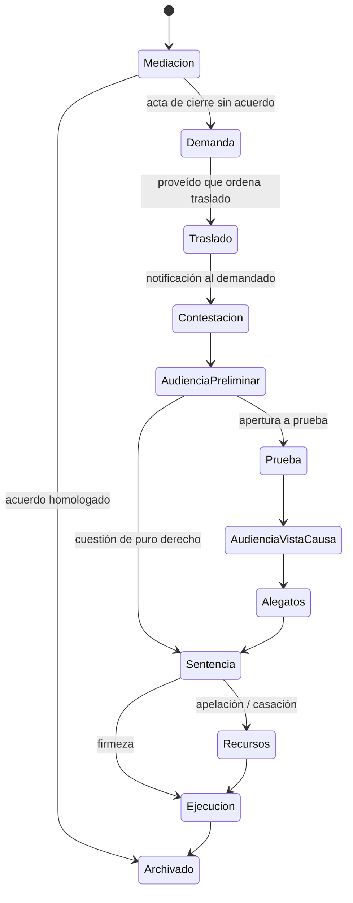

# 02 — Área Expedientes

## 1. Descripción

Es el núcleo del sistema. Cada expediente reúne todo lo que el abogado necesita saber y hacer sobre una causa: ficha identificatoria, partes, **tipo de proceso con sus etapas**, la **historia del expediente** (todo lo que pasó, en una sola línea de tiempo), escritos redactados en la app, documentos, vencimientos, tareas, gastos, checklists de trámites y los **agentes seleccionados** para trabajar en esa causa.

El objetivo es que al abrir un expediente el abogado responda en segundos tres preguntas: **¿en qué estado está?**, **¿qué vence y cuándo?**, **¿qué tengo que hacer ahora?** Y que cualquier agente que él seleccione pueda responderlas también, apoyándose solo en la historia de ese expediente y en las fuentes que el abogado le dio.

Principio rector de esta área: **el abogado configura**. Las tipos de proceso, sus etapas, los plazos típicos y los agentes disponibles son configuración suya. El sistema trae ejemplos iniciales editables, nunca reglas fijas.

## 2. Desarrollo

### 2.1 Alta y configuración del expediente

Al crear un expediente el abogado elige el **tipo de proceso** (ordinario, sumario, expropiación, el que sea) de su catálogo de Configuración, y con eso el expediente queda posicionado en la **primera etapa** de ese tipo. El tipo de proceso define cómo se comporta el expediente de ahí en adelante. Solo se ofrecen los tipos **activos**; si no hay ninguno configurado, el alta remite a Configuración antes de seguir.

La **carátula** se escribe o se pega como venga del Portal del SAE: el sistema la parte en actor, demandado y objeto, la normaliza y muestra en vivo cómo va a quedar guardada (`10-normalizacion-de-texto.md`).

**Ficha**

| Campo | Detalle |
|---|---|
| Número y año | Formato del SAE (por ejemplo `1234/26`). Único por juzgado. |
| Carátula | "Actor c/ Demandado s/ Objeto". Se escribe o se pega en cualquier variante; el sistema la normaliza y guarda sus tres componentes por separado. |
| Centro judicial | Capital, Concepción, Monteros. |
| Fuero | Civil y Comercial Común, Civil en Documentos y Locaciones, Cobros y Apremios, Familia y Sucesiones, Paz **[a confirmar denominaciones actuales]**. |
| Juzgado | Tipo de juzgado y nominación ("Civil y Comercial Común VI"). Hoy son dos campos libres con sugerencias; cuando exista el catálogo de juzgados de Configuración pasan a ser una referencia, con la secretaría. |
| Oficina de Gestión Asociada | OGA que atiende al juzgado. Campo libre que sugiere las que ya se usaron; con el catálogo de juzgados la trae el juzgado elegido. |
| Clase | Principal o incidente. Define el plazo de caducidad de instancia (§2.11). |
| Último movimiento | Fecha del último movimiento útil, de la que se cuenta la caducidad. Hoy se carga a mano; cuando exista la historia del expediente la escribe la última entrada. |
| Caducidad declarada | Fecha en que el juzgado declaró la caducidad de instancia, si la declaró. |
| Audiencia fijada | Tipo, fecha y hora de la audiencia que fijó el juzgado. Sin fecha no hay audiencia fijada. Pasa a la agenda cuando exista. |
| **Tipo de proceso** | Elegido del catálogo del abogado (ver abajo). Define etapas, plazos típicos, escritos típicos, guías y agentes sugeridos. |
| Materia | Especialidad principal de la causa: daños y perjuicios, consumidor, contratos, prescripción, locaciones, sucesiones, ejecuciones, otra. Editable por el abogado. Sirve para sugerir agentes por especialidad. |
| Rol del cliente | Actor, demandado, tercero, heredero, acreedor, otro. |
| Estado | En mediación, en trámite, suspendido, con sentencia, en ejecución, archivado, paralizado. |
| Etapa actual | Etapa del tipo de proceso en la que está el expediente. |
| Monto | Monto reclamado o base regulatoria, con moneda y fecha. |
| Fechas clave | Inicio de mediación, inicio de demanda, radicación, sentencia, firmeza. |
| Notas y etiquetas | Texto libre y etiquetas para agrupar. |

**Tipos de proceso (Configuración → Tipos de proceso)**

Un tipo de proceso es una configuración del abogado con:

- Nombre y descripción.
- Lista ordenada de **etapas**; hoy, nombre y orden (se escriben una por línea y la clave se genera del nombre). Las transiciones válidas, plazos típicos (del catálogo de plazos), escritos típicos, guías y checklist por etapa se agregan cuando existan esos catálogos.
- Materias en las que suele usarse, que sirven para sugerir agentes.
- Marca de **activo**: solo los activos se ofrecen al dar de alta un expediente.

Catálogo inicial (ejemplos editables, con nombres a confirmar contra la Ley 9531): conocimiento ordinario, conocimiento sumarísimo, sumario, ejecutivo, monitorio, expropiación, sucesorio, desalojo y **personalizado** (el abogado arma las etapas desde cero). La denominación "sumario" del código anterior no existe como tal en la Ley 9531 **[a confirmar]**: se incluye como ejemplo porque el estudio la usa, y como cualquier otro se puede editar o borrar.

Los tipos de proceso se crean, editan, desactivan y borran desde Configuración. Reglas de integridad:

- Cambiar un tipo de proceso **no altera los expedientes ya creados**; el abogado puede "reaplicarlo" a un expediente si lo desea (pendiente).
- Un tipo **en uso por algún expediente no se puede borrar**: se desactiva, así deja de aparecer en las altas nuevas sin dejar expedientes sin etapas. El sistema lo informa con la cantidad de expedientes que lo usan.
- Al borrar un tipo libre, se quita de los agentes que lo tenían asignado.

### 2.2 Etapas procesales como máquina de estados

Cada plantilla define una secuencia de etapas. El sistema guarda la etapa actual y el historial de transiciones (fecha, quién la cambió, entrada de la historia que la motivó). La etapa actual condiciona qué guías, plazos, escritos y agentes se sugieren.

Ejemplo de tipo de proceso para **conocimiento ordinario** (nombres a confirmar contra el texto vigente de la Ley 9531):

Las etapas no son bloqueantes: el abogado puede cambiar la etapa libremente. La máquina de estados sugiere el siguiente paso, ordena las guías y da contexto a los agentes. Si una transición no está prevista en el tipo de proceso, el sistema la permite con una advertencia.

### 2.3 Historia del expediente

**Hecho** (la carga manual asistida y el conector del SAE, pendientes). Es la **línea de tiempo única** del expediente y la fuente principal de comprensión de los agentes. Reúne, en orden cronológico, todo lo que ocurre:

| Tipo de entrada | Origen | Ejemplos |
|---|---|---|
| Actuación del juzgado | SAE (extensión o robot), carga manual | Decreto, interlocutoria, sentencia, cédula, mandamiento, oficio, informe del actuario |
| Presentación del estudio | Abogado (editor de la app o Word importado) | Demanda, contestación, ofrecimiento de prueba; con versiones y estado borrador / presentado |
| Presentación de la contraria | SAE o carga manual | Contestación, recurso, incidente |
| Presentación de un auxiliar | Carga manual | Pericia, informe del perito, acta del mediador |
| Documento | Abogado | Prueba documental, poder, comprobante |
| Evento | Agenda | Audiencia celebrada, mediación, diligencia |
| Nota | Abogado | Observaciones, llamadas, acuerdos verbales |
| Informe de agente | Agente seleccionado | Informe de estado, análisis de una actuación |
| Conversación fijada | Abogado | Un chat con un agente que vale la pena conservar |

Cada entrada guarda **qué pieza es** (decreto, cédula, mandamiento, oficio, informe del actuario, acta, demanda, contestación, escrito, recurso, pericia, documento, nota), **quién la hizo** (el juzgado, el estudio, la contraria, un auxiliar), **cuándo** fue el acto y **cuándo se notificó** —que es de la que corren los plazos, y por eso se guarda aparte—, una línea que dice qué dice, y el **texto completo** de la pieza.

**El texto completo no es un adorno: es el objeto de la pestaña.** Cada actuación se abre y se lee en la misma línea de tiempo, sin salir a otra pantalla, porque el abogado está leyendo la causa desde ahí. Es además lo que van a indexar los agentes: una historia sin textos es una lista de títulos que no sirve para preguntarle nada.

**El decreto que abre una etapa se distingue de todos los demás.** La mayoría de las actuaciones no cambian el estado del juicio; unas pocas sí, y son las que hay que poder encontrar de un vistazo al abrir un expediente que no se mira hace tres meses. La entrada que abre etapa lleva el punto del hilo en el azul del acento, el cuadro teñido y un rótulo que nombra la etapa que abre. **Cargarla mueve al expediente**: pasa a esa etapa con la fecha del acto, en lugar de que el abogado la cambie a mano en Datos. Es el enlace que en el modelo produce la fila de `stage_transitions`.

Por eso tampoco hay una entrada suelta de tipo "cambio de etapa": lo que pasó no fue que el expediente cambió de etapa, sino que **salió un decreto que la abrió**. La etapa es la consecuencia de la actuación y se muestra como tal.

**La historia le escribe al expediente la fecha del último movimiento.** Mientras haya actos de impulso cargados, la fecha del último movimiento útil —de la que se cuenta la caducidad de instancia (§2.11)— sale de la historia y no del campo que se carga a mano. No todo impulsa: un decreto, una presentación del estudio, de la contraria o de un auxiliar sí; una nota, un documento guardado o una audiencia celebrada, no. Si la historia está incompleta hacia atrás, el expediente se va a ver más quieto de lo que está y el semáforo va a avisar de más: es el lado seguro del error, porque una fecha optimista escondería una caducidad en curso, que es justo lo que el semáforo existe para evitar.

**Junto a las entradas se muestran los hechos que cuenta la ficha** —el alta del expediente, la audiencia que ya se celebró, la caducidad declarada—, apagados, marcados como "de la ficha" y sin acciones: pasaron, pero no son piezas del expediente. Van desapareciendo a medida que una entrada los cuenta mejor: si un decreto abrió la etapa actual, sobra la fila "pasa a la etapa X".

Se puede filtrar por lado de la causa —todo, el juzgado, el estudio, la contraria y los auxiliares— con enlaces y no con un control de cliente, así la vista filtrada tiene su propia URL y el botón de atrás funciona.

**En la misma línea que los filtros va el recorrido por las etapas**: un tramo por etapa de la plantilla del tipo de proceso, en gris lo cumplido, en el azul del acento la etapa actual y en la línea del papel lo que falta, con "Contestación · etapa 4 de 12" al lado y el nombre y la fecha de cada tramo al pasar el mouse. Las etapas no son una lista fija del sistema: salen de la plantilla que el abogado configuró para ese tipo de proceso y esa materia (§2.1), así que el recorrido de un ordinario de daños y el de un ejecutivo son distintos porque sus plantillas lo son.

Qué se cumplió se sabe de dos maneras y se usan las dos: por el **orden** de la etapa actual dentro de la plantilla —si está en Prueba, Demanda y Traslado quedaron atrás— y por la **historia**, que además dice con qué actuación y en qué fecha se abrió cada una. La historia es la que tiene la fecha; el orden es el que no deja huecos cuando la historia está incompleta. Una etapa que la historia abrió queda cumplida aunque el proceso haya vuelto atrás: pasó, y volver no lo borra.

El recorrido va acá y no en la cabecera del expediente porque se lee junto con la historia —las etapas las abren las actuaciones de esta misma lista—, mientras que la cabecera dice en qué etapa está, que es otra pregunta.

Las entradas de origen IA se muestran siempre con una marca visible y con la referencia al agente y a la aprobación del abogado. Hoy todo lo carga el estudio; el conector del SAE escribirá `sae`, y lo que un agente proponga y el abogado apruebe, `ia_aprobada`.

Pendiente:

- **Carga manual asistida** (§2.4): pegar el texto o subir el PDF y que la IA proponga qué pieza es, la resuma y calcule los plazos que dispara. Hoy el abogado elige qué es y escribe la línea.
- **Ingesta desde el SAE** con deduplicación por hash y vinculación automática (`09-conector-sae.md`).
- **Efectos** de cada actuación: los vencimientos y las tareas que generó, en la entrada y en Agenda.
- **Adjuntos**: el PDF del decreto, la cédula escaneada, el escrito con su cargo.
- **Historial de etapas**: la historia señala el decreto que abrió cada etapa, pero el expediente guarda solo la etapa actual y desde cuándo, así que borrar esa entrada no devuelve el expediente a la etapa anterior (`stage_transitions`).
- Informes de agentes y conversaciones fijadas como entradas.
- Indexación del texto para la búsqueda y para el RAG.

### 2.4 Incorporación de actuaciones del juzgado

El Poder Judicial de Tucumán no ofrece API. El diseño completo está en `09-conector-sae.md`. Resumen de las vías, en orden de prioridad:

1. **Extensión de navegador (MVP)**: con el abogado logueado en el Portal del SAE, la extensión lee la bandeja de notificaciones y la historia de los expedientes seguidos y las envía al sistema. No guarda credenciales.
2. **Robot en servidor (opcional, fase posterior)**: el sistema ingresa solo al Portal con las credenciales cifradas del abogado, bajo activación explícita y responsabilidad suya.
3. **Carga manual asistida (siempre disponible)**: pegar texto o subir PDF/imagen; la IA clasifica, resume y propone plazos.

Reglas comunes:

- **Deduplicación**: cada actuación importada se identifica por un hash de (expediente, fecha, tipo, texto); si ya existe, se ignora.
- **Vinculación automática** al expediente por número, año y juzgado. Si no existe, el sistema propone crearlo con la carátula y el juzgado detectados.
- Toda actuación importada entra en la historia con origen SAE y dispara el análisis del agente (Flujo 0 en `05-integracion-expedientes-ia.md`).

### 2.5 Redacción de escritos en el expediente

**Hecho el editor y el encabezado** (el panel de IA, las versiones y la exportación a Word, pendientes). El abogado redacta sus escritos **dentro del expediente**, en la pestaña Historia, y lo que presenta vuelve a esa misma lista como una entrada más.

**Editor propio**

Arriba se escribe el **cuerpo** y nada más que el cuerpo; abajo se ve la **hoja**, a tamaño real, como va a salir impresa. La hoja va abajo y no al costado porque mide 21 cm de ancho de verdad: en una columna lateral entraría cortada, y achicarla con un zoom para que entre haría que el abogado apruebe un escrito que no es el que va a imprimir.

**El encabezado sale de los metadatos, no se escribe.** El juzgado con su nominación, la carátula, el número de expediente, el nombre y la matrícula del abogado, su domicilio electrónico y por quién comparece ya están cargados en el expediente, en Configuración y en la nómina de partes (§2.14). Copiarlos a mano de un escrito anterior es de donde sale el clásico escrito presentado con la carátula del expediente de al lado. Lo único que el abogado escribe en el encabezado es la **suma** —qué hace el escrito: "Contesta traslado"—, porque eso no es un metadato.

**Lo que falta no se inventa.** Donde no hay dato va una marca `[[COMPLETAR: …]]`, la misma convención con la que los agentes señalan lo que no encontraron en sus fuentes (`03-ia-agentes.md`), y arriba de la hoja se lista qué falta y en qué pantalla se completa. Un escrito al que le falta la matrícula se ve igual, con el agujero a la vista, en lugar de salir con un dato inventado.

Las **fórmulas de estilo** ("Señor Juez de Primera Instancia…", "a V.S. respetuosamente digo:") y la preposición de cada fuero —"en lo Civil y Comercial Común" pero "de Familia y Sucesiones"— están **[a confirmar]** contra la práctica del estudio, y el destino es que sean plantillas de escrito configurables (`writing_templates`).

**Formato de los escritos (Configuración → Estudio)**

Cómo sale el escrito lo decide el abogado, una vez, para todo el estudio: tipo de letra, tamaño, interlineado, los cuatro márgenes en centímetros —el izquierdo ancho para el cosido—, la sangría de párrafo, si el texto va justificado, y si la carátula del encabezado va en negrita, en mayúsculas y con qué tamaño. Es configuración del estudio y no de cada escrito porque un estudio presenta siempre con la misma forma. Las medidas se acotan a lo que es una hoja: un margen de quince centímetros o un cuerpo de ochenta puntos no son una preferencia, son un error de tipeo. En el modelo va en `profiles.preferencias`.

**Presentación**

Al guardar, el escrito entra en la historia como **presentado** con la fecha que puso el abogado, con lo que impulsa el proceso y corre la fecha del último movimiento útil (§2.3): una presentación del estudio en la historia significa que se presentó. Se guarda el **cuerpo** y no la hoja completa, porque el encabezado se vuelve a armar con los metadatos cada vez que se abre; guardarlo sería guardar dos veces el mismo dato y quedarse con la copia vieja cuando cambie el juzgado.

Mientras se redacta, el borrador se guarda en el navegador: no es una versión del escrito —eso llega con `documents`—, es una red para no perder media hora de redacción si se cierra la pestaña.

**Imprimir y PDF**

La hoja se imprime sola: al imprimir se oculta el resto de la pantalla y la página sale sin márgenes propios, porque los márgenes ya están en la hoja. "Guardar como PDF" del diálogo de impresión da el archivo que se sube al Portal del SAE. La contrapartida asumida es que cualquier otra pantalla de la aplicación también se imprime sin margen: la única pensada para imprimirse es esta.

Pendiente:

- **Panel de IA** (el Redactor u otro agente seleccionado): generar el borrador desde una plantilla de escrito y los datos del expediente, completar campos, reescribir un párrafo, revisar los requisitos del escrito según la etapa, calcular el plazo de presentación. Todo lo que tome de la historia con su referencia.
- **Versiones**: cada guardado una versión, comparables y restaurables (`documents` y `document_versions`), y el estado borrador / presentado. Hoy el borrador vive en el navegador y a la historia entra lo presentado.
- **Word**: importar `.docx` como versión y exportar a `.docx`. Hoy se imprime o se guarda en PDF desde el navegador.
- **Plantillas de escrito** configurables, que son las que deberían traer las fórmulas de estilo y la estructura de cada tipo de escrito.
- **Texto enriquecido** en el cuerpo (negritas, subrayado, listas): hoy el cuerpo es texto y el formato lo pone la hoja.
- Al marcar un escrito como presentado, cerrar el vencimiento asociado si lo había.

### 2.6 Agentes en el expediente

Los agentes se crean y configuran en Configuración → Agentes (`03-ia-agentes.md`). En el expediente, el abogado **selecciona cuáles trabajan en esa causa** desde el panel "Agentes". Por ejemplo: Procesalista Tucumán + Especialista en Daños y Perjuicios.

Cada agente seleccionado opera en **dominio cerrado**: solo ve la historia de este expediente y las fuentes que el abogado le asignó al configurarlo. Ofrece:

- **Informe de estado** (bajo demanda; en v2 también al llegar una notificación): estado actual, qué quedó pendiente, plazos corriendo / vencidos / próximos, advertencias, propuestas. Cada punto con su fuente (entrada de la historia, norma cargada, guía). Se guarda en la historia.
- **Chat con contexto** del expediente.
- **Análisis de una actuación** concreta (qué significa, qué plazo abre, qué conviene hacer).
- **Acciones propuestas** que quedan pendientes de aprobación (crear vencimiento, tarea, cambiar etapa, generar escrito).

El sistema sugiere agentes según la materia del expediente y la etapa actual, pero la selección es del abogado.

### 2.7 Vista "estado del expediente"

Cabecera fija de la ficha con:

- Tipo de proceso y etapa actual, con fecha desde la que está en esa etapa.
- Última entrada de la historia (fecha y resumen) y última sincronización con el SAE.
- Próximo vencimiento con días hábiles restantes.
- Tareas abiertas y checklist de trámite pendiente.
- **Sugerencias de la IA** pendientes de aprobación y último informe de estado.
- Acciones rápidas: registrar actuación, subir documento, redactar escrito, calcular plazo, pedir informe de estado, preguntar a un agente.

### 2.8 Búsqueda

**Buscador del listado (hecho).** Un solo campo que encuentra el expediente por número o por parte, escribiendo como resulte más cómodo:

- **Por número**, entero o parcial: "1234", "123" o "1234/26" llegan al 1234/26.
- **Por parte**: actor o demandado, y también objeto y materia.
- **Sin tildes ni mayúsculas**: "nicolas" encuentra a "Nicolás", "danos" encuentra "Daños". La consulta y el dato se reducen los dos a una forma comparable (`normalizarParaBuscar`, `10-normalizacion-de-texto.md`), así que da igual cómo se escriba de los dos lados.
- **Por palabras, en cualquier orden**: "juan perez" encuentra "Pérez, Juan"; se exige que todas las palabras estén en el mismo expediente.
- **Por juzgado y por OGA**: el juzgado con su nominación y la Oficina de Gestión Asociada también entran en la búsqueda, además de tener su propio filtro.
- **Filtra en la misma tecla**: el filtrado corre en el cliente sobre la lista ya cargada, sin ida y vuelta al servidor. La consulta y los filtros se reflejan en la URL (`?q=`, `?estado=`, `?materia=`, `?fuero=`, `?juzgado=`, `?oga=`) para poder compartir o volver a una vista, y un enlace con esos parámetros abre el listado ya filtrado.

**Filtros del listado (hecho).** Cinco desplegables junto al buscador —**juzgado**, **OGA**, **estado**, **materia** y **fuero**— que se combinan entre sí y con la búsqueda. Solo ofrecen los valores que existen en los expedientes cargados, con la cantidad de cada uno: un desplegable con los siete estados posibles cuando el estudio usa dos invita a elegir combinaciones que no devuelven nada. Cuando hay algo filtrado aparecen el conteo ("3 de 12") y un botón para limpiar.

El filtro por juzgado compara el juzgado **con su nominación**: la VI y la IV del mismo fuero son dos juzgados distintos y no se mezclan. Mientras no exista el catálogo de juzgados de Configuración, los valores salen de lo que se cargó en los expedientes, así que dos formas de escribir el mismo juzgado son dos entradas del desplegable; la normalización del texto al guardar es lo que evita que eso pase seguido.

Pendiente:

- Filtrar también por etiqueta cuando existan las etiquetas.
- Texto completo dentro de la historia de un expediente o de todo el estudio.
- Búsqueda semántica (mismo índice que usa el RAG) para preguntas del tipo "¿en qué expedientes se discutió la prescripción bienal?".

### 2.9 Listado y tablero

**Hecho.** Un cuadro por expediente —la burbuja que el abogado lee antes de entrar—, separados entre sí, sobre una **rejilla de dos columnas y tres filas**: lo que describe la causa a la izquierda, lo que describe su estado a la derecha, y cada fila enfrentada con la que le corresponde.

| | Izquierda: de qué expediente se trata | Derecha: situación procesal (§2.11) |
|---|---|---|
| 1 | Número en versalitas | |
| 2 | **Carátula** con su estructura visible: las partes en negrita, los conectores "c/" y "s/" en itálica apagada, el objeto en tono más liviano. Las dos partes se muestran igual: el rol del cliente se consulta en la ficha | **Semáforo** con su color: en trámite, para caducidad, caduco |
| 3 | **Dónde tramita**: juzgado con su nominación, Oficina de Gestión Asociada y centro judicial, y a continuación la **audiencia fijada** con su tipo, fecha y hora si hay una, con un calendario en los colores del emoji 📅 | **Etapa** en que quedó el expediente |

Es una rejilla y no dos columnas sueltas porque las filas tienen que quedar enfrentadas: el semáforo a la altura de la carátula y la etapa a la del juzgado, sin depender de que los dos bloques midan lo mismo. La tercera fila arranca separada de la carátula, para que la identidad de la causa se lea como un bloque y el trámite como otro.

**El detalle del movimiento no va en la burbuja**: en el listado alcanza el color, y de dónde sale ese color —"sin movimiento desde el 11/05/2026", "faltan 6 días para la caducidad", "caducidad declarada el 12/06/2026"— aparece al pasar el mouse por el semáforo y explicado en la ficha. Así el texto de la burbuja no compite con el color.

**Los dos colores de la burbuja dicen cosas distintas.** El semáforo es el único que lleva color de **estado** —verde, amarillo, rojo— y es el que avisa. La audiencia, en cambio, no es un estado sino una fecha tomada, y se marca con un **calendario dibujado en los colores del emoji 📅**: banda roja arriba, hoja de papel abajo. Es el único dibujo en color de toda la lista, y es a propósito: en una pantalla de burbujas grises, el expediente con audiencia fijada tiene que encontrarse sin leer. No se confunde con el semáforo porque el semáforo es un chip con texto en la columna de la derecha, y porque no hay audiencias "verdes" ni "rojas". El texto de la audiencia queda en gris: el color lo pone el calendario y no la línea entera.

El calendario va dibujado a mano —no es el carácter 📅 puesto en el texto— porque el emoji lo dibuja cada sistema a su manera y hereda la línea de base de la tipografía, que lo deja desalineado del resto de la fila. Y va un punto más grande que el ícono del juzgado, 16 contra 14, para que la banda roja se lea a ese tamaño.

**No se muestran** la materia ni el tipo de proceso: el tipo ya surge de la carátula y la materia es un dato de la ficha, donde sirve para sugerir agentes. Ese lugar lo ocupa lo que el abogado necesita para decidir si tiene que actuar hoy.

Una audiencia cuya fecha ya pasó no se muestra en la burbuja —no es una audiencia fijada— pero sí en la ficha, marcada como pasada: la burbuja es para lo que queda por hacer.

En pantalla angosta las dos columnas se apilan en el orden de la rejilla. Encabezado propio del área, fijo al hacer scroll, con el buscador, los filtros y la acción de alta.

Este dibujo dejó de ser propio del área: vive en `components/Registro.tsx` y lo usan también las listas de tipos de proceso y de agentes, con la misma regla de color y de hover (`07-arquitectura.md` §3.6).

Pendiente:

- Listado con columnas configurables: carátula, juzgado, tipo de proceso, etapa, materia, próximo vencimiento, última entrada, estado, última sincronización.
- Filtros guardados ("con vencimiento esta semana", "en prueba", "para caducidad", "sin sincronizar hace 3 días").
- Que el último movimiento lo escriba la historia del expediente en lugar de cargarse a mano.

### 2.10 Configuración a cargo del abogado

Área "Configuración" con estas secciones:

| Sección | Estado |
|---|---|
| **Estudio**: datos del abogado (nombre, matrícula, CUIT, domicilio electrónico) y preferencias (centro judicial habitual, modelo por defecto, corrección de tildes) | hecho |
| **Tipos de proceso** y sus etapas | hecho |
| **Agentes** especializados (`03-ia-agentes.md`) | hecho |
| Catálogo de plazos por acto (compartido con Agenda) | pendiente |
| Plantillas de escritos | pendiente |
| Materias / especialidades (hoy se escriben libremente y se sugieren las ya usadas) | pendiente |
| Juzgados y secretarías | pendiente |
| Dispositivos SAE (`09-conector-sae.md`) | pendiente |

Todo lo anterior viene con ejemplos iniciales que el abogado puede editar o borrar.

### 2.11 Caducidad de instancia

**Hecho.** Es la primera regla de derecho procesal que el sistema aplica sobre el expediente, y la que contesta la pregunta del listado: *¿este expediente se está cayendo?*

| Situación | Color | Cuándo |
|---|---|---|
| **En trámite** | verde | Hay instancia en curso y el expediente se movió dentro del plazo. |
| **Para caducidad** | amarillo | Se cumplieron los meses sin movimiento: **seis** en el principal, **tres** en los incidentes **[a confirmar contra el texto vigente de la Ley 9531]**. También el expediente que el abogado marcó como paralizado, aunque las fechas no lleguen al plazo: esa marca es suya. |
| **Caduco** | rojo | El juzgado declaró la caducidad. |
| El estado cargado | gris | No hay instancia en curso que pueda caducar: en mediación previa, suspendido, con sentencia, en ejecución o archivado. |

Reglas del cómputo (`src/lib/procesal/caducidad.ts`, con tests):

- **La situación no se guarda: se deduce.** Lo que se guarda son hechos —la fecha del último movimiento y, si ocurrió, la fecha en que el juzgado declaró la caducidad—. Un estado derivado que se persiste queda viejo solo con que pase el tiempo.
- El plazo corre por **meses corridos**, no por días hábiles, así que no interviene el calendario de feriados. Si el día no existe en el mes de destino se usa el último de ese mes (31/03 + 6 meses = 30/09), como manda el artículo 6 del Código Civil y Comercial.
- El orden de las reglas es el del derecho: la caducidad declarada tapa todo lo demás; después se ve si hay instancia en curso; solo entonces se cuentan los meses.
- Si el expediente no tiene fecha de último movimiento —los que se cargaron antes de que existiera el campo—, se usa la fecha desde la que está en la etapa actual, y en última instancia la de carga.
- Faltando treinta días o menos, el detalle avisa cuántos quedan aunque el semáforo siga en verde.
- El día de hoy entra como dato desde el servidor y no se lee del reloj en cada fila: el semáforo tiene que dar lo mismo en el HTML inicial y después de la hidratación, y los tests necesitan fijarlo.

Dónde se ve: en el **listado**, el color del semáforo, con el detalle al pasar el mouse (§2.9); en la **ficha**, el semáforo y el cómputo escrito —de qué fecha se cuenta, cuándo se cumple el plazo y cuántos días faltan—, que es lo que el abogado necesita para decidir si impulsa el expediente hoy.

Pendiente: que los plazos sean configurables junto con el catálogo de plazos, que el último movimiento lo escriba la historia del expediente, y que un expediente para caducidad genere una tarea en Agenda en lugar de esperar a que el abogado lo vea en el listado.

### 2.12 Contabilidad del expediente

**Hecho en su parte de registro.** Contesta dos preguntas con los mismos datos, y la segunda es la que le da sentido a la primera:

1. **Hacia atrás: ¿cuánto salió este juicio?** Es lo que hay que rendirle al cliente, y lo que el abogado necesita para saber cuánto puso de su bolsillo.
2. **Hacia adelante: ¿cuánto sale un juicio de esta materia?** Con la contabilidad de los expedientes ya tramitados, el abogado puede decirle a un cliente nuevo, antes de iniciar, qué orden de magnitud tiene el juicio que viene a consultar. Es el **promedio por materia**, y está pendiente (ver abajo).

Cada **partida** tiene fecha, tipo, concepto, detalle, importe, moneda y situación. Corresponde a la tabla `fees_expenses` de `06-modelo-de-datos.md`, con dos decisiones propias de la implementación:

- **El concepto es un catálogo cerrado, no texto libre**: tasa de justicia, aportes a la Caja de Previsión, bono de movilidad, mediación, pericia, cédulas y notificaciones, edictos, informes, movilidad, sellados, honorarios y otro. Es la columna por la que se va a promediar, y dos formas de escribir "tasa de justicia" serían dos conceptos distintos. Las denominaciones de bonos y aportes están **[a confirmar]** (`08-roadmap.md`, punto 8).
- **El importe se guarda en centavos**, como entero. Sumar veinte partidas con decimales de punto flotante da un total que no cierra por un centavo, y el total es justamente lo que se le informa al cliente.

| Tipo | Qué es |
|---|---|
| Gasto | Erogación del juicio: lo que hubo que pagar para que el expediente avance. |
| Honorario pactado | Lo convenido con el cliente. |
| Honorario regulado | Lo que reguló el juzgado. |

Los honorarios van en la misma lista que los gastos porque la pregunta "cuánto sale el juicio" los suma a los dos: para el abogado son ingreso, para el cliente son costo. El `tipo` es lo que permite separarlos, y la pestaña muestra los dos totales por separado además del total.

| Situación | Qué significa |
|---|---|
| Previsto | Todavía no se pagó. Es **la parte estimada** del costo, y lo que hace posible proyectar el juicio antes de que termine. |
| Pagado por el estudio | Lo adelantó el estudio y está pendiente de rendición al cliente (el "a rendir" de `01-agenda.md` §2.6). |
| Rendido | El cliente ya le reintegró al estudio. |
| Pagado por el cliente | Lo pagó el cliente directamente; el estudio no puso dinero. |

**Los totales no se guardan: se calculan** (`src/lib/contabilidad`, con tests), por la misma razón que la situación de caducidad se deduce (§2.11). Un total persistido queda viejo con la primera partida que se agregue.

**Cómo se muestra** (pestaña Contabilidad de la ficha): el **costo total** como una sola cifra protagonista —no un gráfico de una barra—; **lo pagado contra el total** como un medidor, que es una proporción contra un límite; el desglose **por concepto** como barras horizontales de una sola serie, ordenadas de mayor a menor, que contestan "en qué se va el dinero"; y la lista de partidas debajo, que es la misma información en forma de tabla. Las barras van en gris: en esta aplicación el color está reservado —el acento marca dónde estoy, el semáforo marca el riesgo procesal— y acá la magnitud ya la lleva el largo de la barra.

Pendiente:

- **Promedio por materia**: cuánto salió en promedio un juicio de daños, de desalojo o de cobro ejecutivo, calculado sobre los expedientes ya cargados y desglosado por concepto, para estimarle el costo a un cliente antes de iniciar. El dato ya se guarda con la forma que esto necesita —`expedienteId` para llegar a la materia del expediente, `concepto` acotado y `fecha` en cada partida—, así que es un cálculo y no un cambio de modelo.
- **Importes comparables en el tiempo**, que es el problema de fondo del promedio: con la inflación argentina, promediar pesos de 2026 con pesos de 2029 no da una cifra que sirva para cotizar. Hay que reexpresar cada partida a la fecha del cálculo (índice de precios, JUS o UMA) antes de promediar. Por eso toda partida guarda su fecha, incluso la prevista.
- Comprobante adjunto de cada partida (bucket privado `receipts` de `06-modelo-de-datos.md` §7), que es lo que pide la rendición al cliente.
- Convenio de honorarios con cuota litis; honorarios regulados con su instancia y la comunicación a la Caja de Previsión (Ley 5480).
- **Costas**: a cargo de quién quedaron y qué parte del gasto se recupera de la contraria. Hoy la contabilidad dice qué salió, no quién lo termina soportando.
- Selector de moneda: el campo existe en el modelo, pero en pantalla toda partida es en pesos.
- Totales por cliente y pendientes de cobro, que son del área Agenda (`01-agenda.md` §2.6).

### 2.13 La ficha por pestañas

La ficha del expediente es un cuadro con una pestaña por cara, y cada pestaña es una **ruta propia** (`/expedientes/<id>/partes`): se puede compartir el enlace de una pestaña y el botón de atrás funciona. `/expedientes/<id>` sin segmento lleva a la primera.

Afuera del cuadro queda la cabecera fija de §2.7 —carátula, número, tipo de proceso, etapa y el semáforo—, visible en cualquier pestaña. Adentro, la tira de pestañas se reparte todo el ancho con ícono y rótulo, y cada una responde además a una **tecla de función**, en el orden de la lista: Datos (F1), Partes (F2), Agenda (F3), Historia (F4), Resumen (F5), Contabilidad (F6) e IA (F7). La tecla va escrita debajo del rótulo porque un atajo que no se ve no existe.

El orden de las pestañas vive en un solo lugar (`src/app/expedientes/[id]/pestanas.ts`) y de ahí salen la tira, los atajos y las rutas, con un test que verifica que las tres cosas no se separen.

### 2.14 Las partes del expediente

**Hecho.** La pestaña **Partes** contesta quiénes litigan, cómo se los notifica y quién es exactamente el cliente. Es la nómina de `case_parties` (`06-modelo-de-datos.md`), con nueve roles: actor, demandado, citado en garantía, tercero, letrado de la contraria, perito, mediador, síndico y otro.

**Se lee por lados, no por roles.** Una lista plana de nueve roles no se lee: el abogado piensa el juicio en lados —acá los míos, enfrente los otros, alrededor los auxiliares del juzgado—. La nómina se agrupa en **parte actora**, **parte demandada** (con su citada en garantía, que litiga junto al demandado aunque no haya sido demandada) y **terceros y auxiliares**. El tercero va con los auxiliares y no con un lado porque hasta que no se resuelve cómo interviene no se sabe de qué lado está.

**Los letrados cuelgan de su representado.** Un letrado de la contraria no es una fila suelta de la nómina: es *el abogado de esa parte*, y así se lo encuentra cuando hay que llamarlo. Se lo vincula con "representa a" y se muestra sangrado debajo de su representada. No se admiten cadenas de dos saltos —un letrado de un letrado—, y si el representado se borra, el letrado no desaparece: queda como una fila más, para que no se pierda de vista.

**La carátula es el arranque de la nómina, no una copia de ella.** El actor y el demandado ya están escritos en la carátula, así que la pestaña no los vuelve a pedir: mientras un lado no tenga su parte cargada, ofrece **sumarlo con un clic** y el abogado completa después el documento y los domicilios, que es cuando llegan. La comparación es por nombre normalizado —sin tildes ni mayúsculas, igual que el buscador del listado—, así que "Swiss Medical ART" cargada a mano no vuelve a ofrecerse.

**El dato que se viene a buscar es el domicilio electrónico.** Sin la casilla del SAE no se notifica, así que es el único dato que, cuando falta, se muestra en lugar de omitirse. Y solo en quienes se notifica: al perito lo notifica el juzgado por su canal y la mediadora ya terminó su intervención, así que reclamarles la casilla sería un aviso que el abogado no puede ni necesita resolver.

**Quién es el cliente.** El rol del cliente de la ficha (§2.1) dice de qué **lado** está el estudio; la nómina dice **quién** es, que no es lo mismo cuando de ese lado hay tres litisconsortes. Hay un solo cliente por expediente —es `cases.client_id` visto desde la parte—, así que marcar a uno se lo quita a cualquier otro. Cuando el lado que se suma desde la carátula es el del cliente, la parte nace ya marcada.

**Lo que se guarda adentro y debería estar afuera.** En el modelo, la parte es el cruce entre el expediente y un **contacto**: el rol y a quién representa van en `case_parties`, y el documento, los domicilios y el teléfono en `contacts`, que se comparte entre expedientes. Mientras esa agenda de contactos no exista, la parte guarda esos datos adentro —igual que el expediente guarda hoy el juzgado en sus propias columnas hasta que exista `courts`—, con la misma consecuencia: un cliente con tres juicios se carga tres veces. La migración es un `contacts` por cada nombre distinto y una referencia en su lugar.

Pendiente:

- **Agenda de contactos del estudio** (`contacts`), que es lo que termina con la carga repetida, y el vínculo del cliente con sus otros expedientes.
- **Encabezado de escrito** armado con esta nómina: carátula, partes, documentos y domicilios constituidos, sin volver a tipearlos (§2.5).
- Cédulas y notificaciones a los domicilios electrónicos cargados.
- Aseguradoras con su póliza y su cobertura; peritos con su especialidad y su matrícula.

## 3. Funcionalidad

### MVP

- [x] Alta, edición y baja de expedientes, eligiendo el tipo de proceso en el alta.
- [x] Carátula normalizada, con sus componentes guardados por separado (`10-normalizacion-de-texto.md`).
- [ ] Baja lógica y archivo de expedientes (hoy la baja es definitiva).
- [x] Nómina de partes con sus roles, documentos y domicilios, agrupada por lado, con los letrados colgando de su representado y el arranque desde la carátula (§2.14).
- [ ] Ficha completa: montos, fechas clave, etiquetas.
- [x] Tipos de proceso configurables (crear, editar, desactivar, borrar) con ejemplos iniciales para ordinario, sumarísimo, sumario, ejecutivo, monitorio, expropiación, sucesorio y desalojo.
- [ ] Etapas con historial de transiciones y advertencia en transiciones no previstas (hoy se guarda la etapa actual y desde cuándo).
- [x] Historia del expediente: actuaciones del juzgado, presentaciones del estudio, de la contraria y de los auxiliares, documentos y notas, cada una con su texto completo consultable; el decreto que abre etapa distinguido y moviendo al expediente; filtros por lado de la causa (§2.3).
- [ ] Indexación del texto de la historia para la búsqueda y para el RAG de los agentes.
- [ ] Carga manual asistida de actuaciones (texto o PDF) e ingestión desde la extensión del SAE con deduplicación y vinculación automática.
- [x] Editor de escritos con el encabezado armado desde los metadatos, el formato del estudio configurable, impresión y PDF desde el navegador (§2.5).
- [ ] Editor de escritos: panel de IA, versiones, texto enriquecido e importación y exportación Word.
- [x] Recorrido por las etapas del tipo de proceso en la historia: qué se cumplió y qué falta (§2.3).
- [ ] Documentos con subida, extracción de texto y clasificación propuesta.
- [ ] Panel de agentes seleccionados por expediente e informe de estado bajo demanda (hoy la ficha sugiere agentes por materia y tipo de proceso).
- [ ] Vencimientos y tareas generados desde la historia, visibles en Agenda.
- [x] Buscador del listado por número y por partes, sin tildes ni mayúsculas.
- [x] Filtros por juzgado, OGA, estado, materia y fuero, combinables y reflejados en la URL.
- [x] Semáforo de caducidad de instancia en el listado y en la ficha (§2.11).
- [x] Ficha por pestañas, cada una con su ruta y su tecla de función (§2.13).
- [x] Contabilidad del expediente: alta y baja de partidas, costo total, pagado contra previsto y desglose por concepto (§2.12).
- [ ] Promedio de costo por materia sobre los expedientes cargados, con los importes reexpresados para que sean comparables en el tiempo (§2.12).
- [ ] Comprobante adjunto de cada partida y tratamiento de las costas (§2.12).
- [ ] Vista "estado del expediente" y filtros guardados (hoy hay listado con buscador, filtros y ficha básica).

### v2

- [ ] Robot de sincronización con el SAE (opt-in).
- [ ] Informe de estado automático al llegar una notificación.
- [ ] Tipos de proceso para incidentes y cautelares; tipos de proceso y agentes compartibles entre usuarios.
- [ ] Comparación visual entre versiones de escritos.
- [ ] Reportes: expedientes por etapa, por juzgado, antigüedad, productividad, y costo de los juicios por materia.
- [ ] Portal de clientes de solo lectura.
- [ ] Multiusuario con asignación de expedientes.
